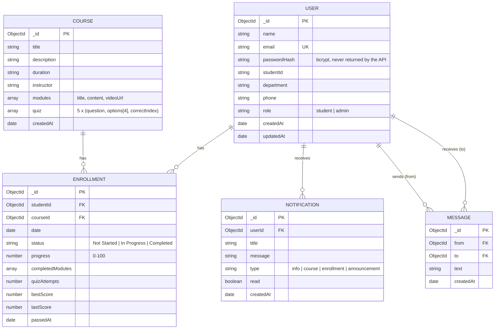

# ACADEXA – Database Schema (MongoDB / Mongoose)

## ER Diagram

## Collections

| Collection | Key fields | Constraints |
|---|---|---|
| `users` | name, email, passwordHash, studentId, department, phone, role | `email` unique + lowercase + regex, `role` enum, name 2-80 chars |
| `courses` | title, description, duration, instructor, modules[], quiz[] | title 3-120 chars; title/description/duration required; quiz is empty or **exactly 5** questions with 4 options each |
| `enrollments` | studentId, courseId, date, status, progress, completedModules[], quizAttempts, bestScore, lastScore, passedAt | **unique compound index (studentId, courseId)** - no double enrollment; progress 0-100 |
| `notifications` | userId, title, message, type, read | indexed by `userId` |
| `messages` | from, to, text | text 1-1000 chars, indexed by `from` and `to` |

## Relationships
* One **user** (student) can enroll in many **courses**; one course has many students → many-to-many resolved by **enrollments**.
* One user receives many **notifications** (deleted together with the user).
* **messages** link two users (`from` → `to`) and power the real-time chat.
* Deleting a student removes their enrollments, notifications and messages. Deleting a course removes its enrollments.

## Progress rules
Finishing all modules = 80% progress; passing the quiz (3 of 5) = 100% and status `Completed`. Progress cannot be edited directly by the student.
